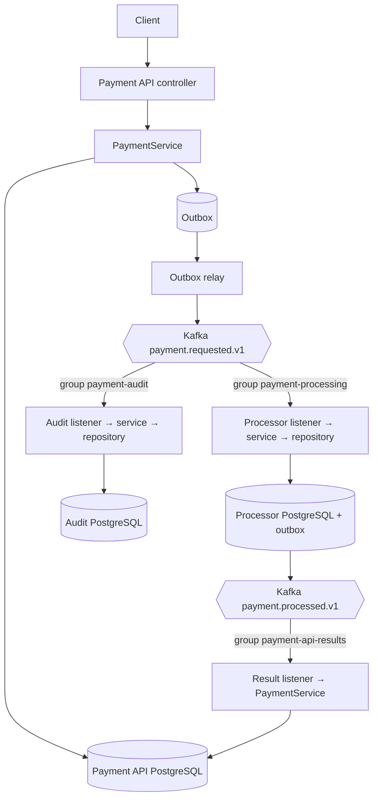

# Kafka Payment Lab — Spring Boot 4, Gradle Groovy DSL

Educational multi-service event-driven payment **simulation** (no real money movement).

## Modules

- `contracts`: versioned Java event records and topic names
- `payment-api`: REST endpoints, payment application service, JPA `PaymentRepository`, specifications, PostgreSQL outbox, payment-result listener
- `payment-processor`: separate Kafka consumer group, processing service and repository, own database and outbox
- `audit-service`: independent consumer group, audit service and repository, own database

## Architecture



Both independent consumer groups receive each requested event. Messages are keyed by payment ID to preserve ordering *within a Kafka partition*, not globally.

## Run locally

Requires Java 21, Gradle 9.x, Docker Compose. The Gradle wrapper is not included; generate it with `gradle wrapper` after installing Gradle.

```bash
docker compose up -d
gradle :payment-api:bootRun
gradle :payment-processor:bootRun
gradle :audit-service:bootRun
```

Each `bootRun` command needs its own terminal. Kafka is advertised at `localhost:9092` to applications running on the host.

```bash
curl -i -X POST http://localhost:8080/payments -H 'Content-Type: application/json' -d '{"amount":12.50,"currency":"GBP"}'
curl http://localhost:8080/payments/<payment-uuid>
```

## Admin payment search

`GET /admin/payments` uses Spring Data `Page<PaymentResponse>`, `Pageable` and composable JPA `Specification` filters. Example:

```bash
curl 'http://localhost:8080/admin/payments?status=APPROVED&currency=GBP&page=0&size=20&sort=createdAt,desc'
curl 'http://localhost:8080/admin/payments?createdFrom=2026-01-01T00:00:00Z&createdTo=2026-12-31T23:59:59Z&sort=amount,asc'
```

Allowed sort fields: `createdAt`, `amount`, `currency`, `status`, `id`; maximum page size: 100. Invalid status/date parameters return 400. **This admin endpoint is unprotected in the lab**; see `SECURITY.md`.

## Test

```bash
gradle test
```

Testcontainers requires a running Docker daemon. Tests include payment/outbox atomicity, filtered/sorted pagination and idempotent processing when an event is delivered twice. A *true* broker restart/offset replay end-to-end test remains future work.

## Docker Builds

Example docker build commands passing in APP_MODULE as build arg 

```bash
docker build --build-arg APP_MODULE=payment-api -t payment-api:latest .
docker build --build-arg APP_MODULE=payment-processor -t payment-processor:latest .
docker build --build-arg APP_MODULE=audit-service -t audit-service:latest .
```

## Docker Run

Example docker run commands passing in postgres DB_URL and netwotk

```bash
docker run --name payment-api -e "DB_URL=jdbc:postgresql://postgres:5432/payment_api" --network kafka-payment-lab_app-db payment-api:latest
docker run --name payment-processor -e "DB_URL=jdbc:postgresql://postgres:5432/payment_processor" --network kafka-payment-lab_app-db payment-processor:latest
docker run --name audit-service -e "DB_URL=jdbc:postgresql://postgres:5432/payment_audit" --network kafka-payment-lab_app-db audit-service:latest
```

## Delivery semantics

Payment and outbox insertion occur in the same PostgreSQL transaction. The relay publishes an outbox event and then marks it published. A crash between those steps can cause duplicate Kafka publication. Each consumer records the event ID and applies business changes in one local DB transaction, so replay of the same event ID is harmless. Kafka offset commits are **not** atomic with the PostgreSQL commit.

The demo is not production-ready; read `SECURITY.md` for known gaps, especially multi-instance outbox claiming, authentication, telemetry and broker durability.