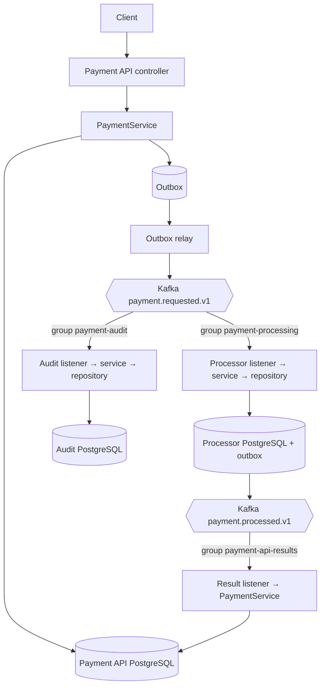

# Kafka Payment Lab — Spring Boot 4, Gradle Groovy DSL

Educational multi-service event-driven payment **simulation** (no real money movement).

## Modules

- `contracts`: versioned Java event records and topic names
- `payment-api`: REST endpoints, payment application service, JPA `PaymentRepository`, specifications, PostgreSQL outbox, payment-result listener
- `payment-processor`: separate Kafka consumer group, processing service and repository, own database and outbox
- `audit-service`: independent consumer group, audit service and repository, own database

## Architecture



Both independent consumer groups receive each requested event. Messages are keyed by payment ID to preserve ordering *within a Kafka partition*, not globally.

## Start the complete containerised stack

Copy `.env.example` to `.env` and adjust the local-only credentials if required. Then build and start PostgreSQL, Kafka and all three Spring Boot applications:

```bash
cp audit-service/.env.example audit-service/.env
cp infra/kafka/.env.example infra/kafka/.env
cp infra/postgres/.env.example infra/postgres/.env
cp payment-api/.env.example payment-api/.env
cp payment-processor/.env.example payment-processor/.env
docker compose up --build -d
docker compose ps
```

The API is available at `http://localhost:8080`; processor and audit health endpoints are on ports 8081 and 8082. `GET /admin/payments` lists stored payments (JWT scope-protected when security is enabled). The Kafka listener inside Compose is `kafka:29092`; host-run applications use `localhost:9092`. Compose waits for PostgreSQL health and Kafka topic initialisation before starting the applications.

To run the Spring Boot apps on the host instead, start only the infrastructure with `docker compose up -d postgres kafka kafka-init` and run `gradle :payment-api:bootRun`, `gradle :payment-processor:bootRun` and `gradle :audit-service:bootRun` in separate terminals.

### Health, metrics and dashboards

- `GET /actuator/health` and `GET /actuator/health/readiness` on each app.
- `GET /actuator/prometheus` exposes Prometheus metrics.
- Start optional monitoring with `docker compose --profile observability up --build -d`; Prometheus is at `http://localhost:9090` and Grafana at `http://localhost:3000` (default local Grafana credentials are `admin` / `admin`; change them before exposing the service beyond your machine).
- The outbox gauges report pending row count and age; counters report publish successes/failures. The processor reports processed and duplicate events. This starter setup does not yet calculate Kafka consumer-group lag.

Submit a simulated payment:

```bash
curl -i -X POST http://localhost:8080/payments \
  -H 'Content-Type: application/json' \
  -d '{"amount":12.50,"currency":"GBP"}'
# GET /payments/{paymentId} returns PENDING initially, then APPROVED
```

Run integration tests (requires Docker):

```bash
gradle test
```
Clean databases (destructive): `docker compose down -v`.

## Admin payment search

`GET /admin/payments` uses Spring Data `Page<PaymentResponse>`, `Pageable` and composable JPA `Specification` filters. Example:

```bash
curl 'http://localhost:8080/admin/payments?status=APPROVED&currency=GBP&page=0&size=20&sort=createdAt,desc'
curl 'http://localhost:8080/admin/payments?createdFrom=2026-01-01T00:00:00Z&createdTo=2026-12-31T23:59:59Z&sort=amount,asc'
```

Allowed sort fields: `createdAt`, `amount`, `currency`, `status`, `id`; maximum page size: 100. Invalid status/date parameters return 400. **This admin endpoint is unprotected in the lab**; see `SECURITY.md`.

## Reliability model

1. **Transactional outbox**: payment row and outgoing event row are committed in one PostgreSQL transaction. The processor also uses an outbox for its result event.
2. **At-least-once publication**: the relay waits for Kafka acknowledgement before marking an outbox row published. If it crashes between those operations, the event can be republished.
3. **Idempotent consumers**: `processed_events(event_id)` has a unique key and is written in the same transaction as business data. Duplicate deliveries have no additional database effect.
4. **Per-key ordering**: all messages for one payment use the payment UUID as the Kafka key; within a topic they map to one partition. Kafka preserves order within each partition, **not** across topics or partitions.
5. **Independent consumers**: `payment-processing` and `payment-audit` each receive the same requested events. Adding instances to *one* group divides partitions among those instances.
6. **Retry and dead-letter**: listener errors retry three times after the initial failure, then publish to a matching `-dlt` topic. Dead-letter messages need operator inspection and safe replay; they are not silently discarded.

## Experiments to demonstrate in an interview

### A. Consumer recovery

1. Stop `payment-processor` while leaving API and audit running.
2. POST three payments. Verify audit rows appear and API responses remain `PENDING`.
3. Restart processor. Verify the backlog is consumed and statuses become `APPROVED`.

### B. Duplicate delivery / crash after DB commit

Run `PaymentProcessorIntegrationTest`: it invokes the same record twice, modelling redelivery after the database transaction committed but the Kafka offset did not. Assert exactly one decision and one outgoing event row. For a stronger live demonstration, deliberately terminate the processor between its DB commit and offset acknowledgement, then restart and inspect row counts.

### C. Ordering

Publish events with the **same payment ID** and inspect Kafka offsets/partitions. They should be in the same partition in append order. Repeat with different payment IDs: ordering between keys is **not guaranteed**. The current domain creates only one requested event per payment, so a meaningful ordering test should add versioned payment-state events and verify their order and monotonic state transitions.

### D. Dead-letter handling

Publish an invalid JSON payload to `payment.requested.v1` using Kafka CLI. After retries, inspect `payment.requested.v1-dlt` and the original consumer logs. Beware that the audit and processor groups can each send a failed event to the same DLT, potentially producing more than one dead-letter record.

## Intentional limits and next improvements

- This is a **learning project**, not a payment platform. There is no money movement, ledger, fraud scoring or external provider integration.
- Outbox rows use expiring database leases and `FOR UPDATE SKIP LOCKED` so multiple relay instances can claim different rows. A crash after Kafka acknowledgement can still cause a duplicate after lease expiry; downstream idempotency remains essential.
- A single-node Kafka broker and three databases on one PostgreSQL instance are development-only.
- An event `eventId` is reused between request and result **across different services' processed-event tables**; event type + ID or unique IDs per event type would be clearer for a broader production schema.
- Kafka is not globally ordered and DB + Kafka is not one distributed transaction. This design achieves **idempotent business effects**, not universal exactly-once delivery.
- Error-handler recovery should be operationally monitored; publishing to a DLT can fail too.
- Add full black-box end-to-end Testcontainers tests and CI after local smoke testing.

For the detailed Docker Compose workflow, service endpoints, Kafka inspection commands and troubleshooting steps, see [Containerised development](docs/containerised-development.md).

## Delivery semantics

Payment and outbox insertion occur in the same PostgreSQL transaction. The relay publishes an outbox event and then marks it published. A crash between those steps can cause duplicate Kafka publication. Each consumer records the event ID and applies business changes in one local DB transaction, so replay of the same event ID is harmless. Kafka offset commits are **not** atomic with the PostgreSQL commit.

The demo is not production-ready; read `SECURITY.md` for known gaps, especially multi-instance outbox claiming, authentication, telemetry and broker durability.